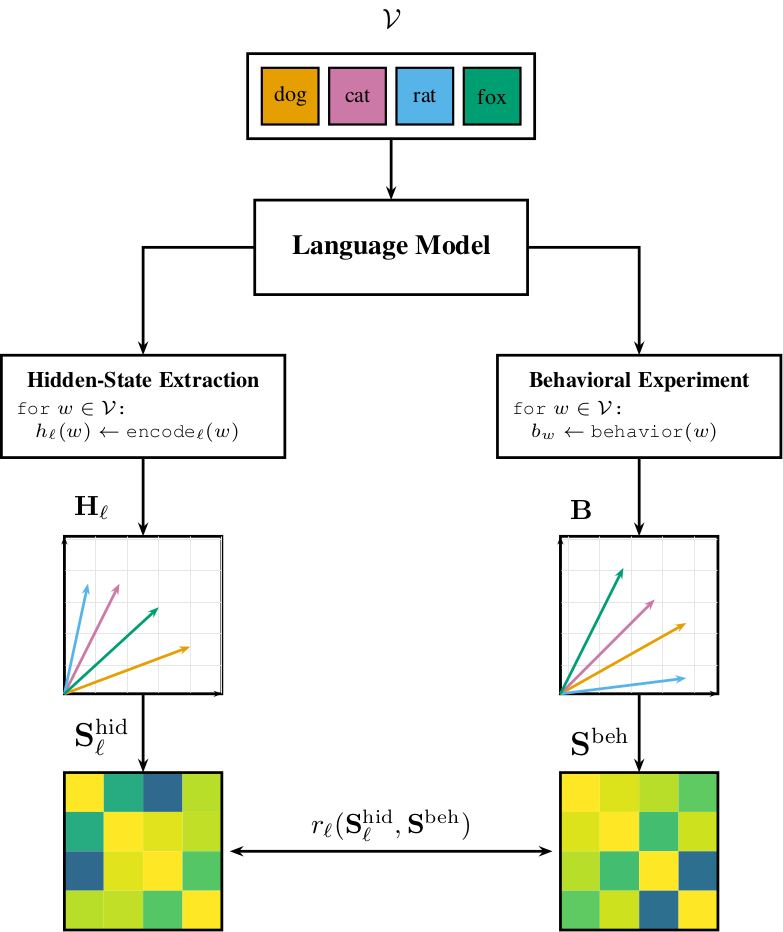

# From Associations to Activations

**Comparing behavioral and hidden-state semantic geometry in LLMs.**

> **Published at ICML 2026** · [Paper](https://arxiv.org/abs/2602.00628) · [Dataset on Hugging Face](https://huggingface.co/datasets/schiekiera/llm-association-geometry) · [Blog post](https://schiekiera.github.io/blog/2026/neural-semantic-geometry/)

We collect word associations from eight instruction-tuned LLMs (7B–14B) over 5,000 English
nouns, under two paradigms: **forced choice** (pick the two most related of 16 candidates) and
**free association** (generate five associates). The resulting behavioral similarity matrices
are compared to layer-wise hidden-state similarity with RSA. Forced choice aligns far better
(*r* = .463 vs. .199) and predicts hidden-state structure for held-out words.

<p align="center"></p>

<br>

## Data

The 17.5 million behavioral trials are on
[Hugging Face](https://huggingface.co/datasets/schiekiera/llm-association-geometry) as Parquet.

```python
from datasets import load_dataset

fc = load_dataset("schiekiera/llm-association-geometry", data_files="forced_choice/*.parquet")
fa = load_dataset("schiekiera/llm-association-geometry", data_files="free_association/*.parquet")
```

<br>

## Reproduce the paper

The scripts in `scripts/` run in order:

|                                   |                                                          |
| --------------------------------- | -------------------------------------------------------- |
| `01_preprocessing/`               | vocabulary from SUBTLEX, C4 sentences, lexical baselines |
| `02_get_behavioral_associations/` | forced-choice and free-association collection            |
| `03_get_hidden_states/`           | layer-wise hidden states and similarity matrices         |
| `04_postprocessing/`              | count matrices, PPMI, behavioral similarity              |
| `05_eval/`                        | RSA and nearest-neighbor overlap                         |
| `06_predict/`                     | held-out-word ridge regression                           |
| `07_plots/`                       | figures                                                  |

The vocabulary and the cached results behind all figures and tables are in `data/`.

<br>

## Citation

```bibtex
@inproceedings{schiekiera2026associations,
  title     = {From Associations to Activations: Comparing Behavioral and Hidden-State Semantic Geometry in {LLM}s},
  author    = {Schiekiera, Louis and Zimmer, Max and Roux, Christophe and Pokutta, Sebastian and G{\"u}nther, Fritz},
  booktitle = {Proceedings of the 43rd International Conference on Machine Learning},
  series    = {Proceedings of Machine Learning Research},
  volume    = {306},
  pages     = {108177--108203},
  publisher = {PMLR},
  year      = {2026},
  url       = {https://proceedings.mlr.press/v306/schiekiera26a.html}
}
```
